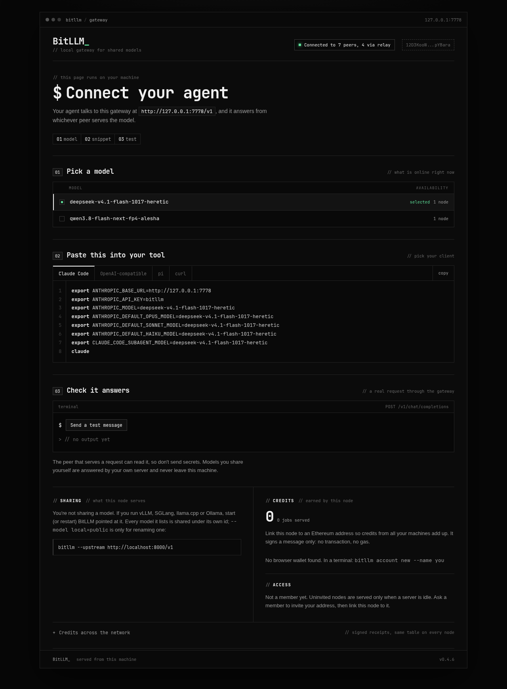

# BitLLM_

[](https://github.com/bitllm-org/bitllm/actions/workflows/test.yml)
[](https://github.com/bitllm-org/bitllm/releases)
[](LICENSE)

English | [中文](README.zh.md)

> Using an AI agent? Point it at https://bitllm.org/llms.txt. Changing the code? See [AGENTS.md](AGENTS.md).

**BitTorrent for local LLMs.** Share your local model, use everyone's.

Every node runs the same binary. It can share an OpenAI-compatible server you already run
(vLLM, SGLang, llama.cpp, Ollama, LM Studio, MLX...), and it gives you a local gateway that
answers from whichever peer serves the model you ask for. There is no coordinator: peers find
each other through a Kademlia DHT and gossip, connect directly when they can, and go through a
relay plus hole punching when both sides are behind NAT.

Invite-only beta, MIT licensed. The network is live at [bitllm.org](https://bitllm.org), and the
[access rules](#how-access-works) decide who gets a slot. Using it needs no account and no wallet.



## How the network fits together

Three roles, one binary:

```
   your node                    seed                     GPU host
  127.0.0.1:7778          DHT, relay, receipts        vLLM / Ollama
        │                        ▲                         ▲
        │  first contact         │                         │
        └────────────────────────┘                         │
        │                                                  │
        └──────── direct, or relay + hole punch ───────────┘
```

- **Your node** runs the same binary as everyone else. Its gateway listens on
  `127.0.0.1:7778` and speaks OpenAI and Anthropic, so an agent points at it
  like any API. Nothing on the internet can call the gateway.
- **A serving node** is your node plus `--upstream`, pointed at a model server
  you already run. It can be behind NAT: peers reach it through a relay and
  hole punching, so no port forwarding is needed.
- **A seed** is a small always-on public host. It answers DHT queries,
  relays for NATed peers, and serves the receipt history a new node syncs on
  join. It serves no model. A new node needs one reachable seed, or a join
  code, to learn about the rest; the seed is not in the inference path unless
  it is relaying.

Discovery has two steps. The binary resolves `_dnsaddr.bootstrap.bitllm.org`
to get seed addresses, then the DHT and gossip carry everything else: which
peer serves which model, and how to reach it. If the name does not resolve,
it tries the `boot.bitllm.org` fallback; if that fails too, the node starts
alone and prints a join code that another machine can pass to `--bootstrap`.

Only these pieces are centrally hosted, and none of them carries inference
traffic:

| piece | where | what it does | if it is down |
|---|---|---|---|
| DNS seed list | Cloudflare DNS, `_dnsaddr.bootstrap.bitllm.org` | names the seeds for first contact | a node with a join code still joins; `boot` covers a missing record, not a dead zone |
| site and installers | Cloudflare Worker, bitllm.org | the page, `install.sh`, `llms.txt` | installed nodes keep running; install by hand from GitHub |
| release binaries | GitHub | downloads, checksums, self-update | no new installs or updates |

Everything else is peer to peer: no coordinator, no database, no KV store, and
no live map. Cloudflare serves DNS and the static site, not inference; the one
exception is traffic relayed through the temporary `boot` tunnel. DNS is used
only to find the first peer; an inference request goes from your gateway to the
serving peer, directly or through a relay. The Mac mini that runs
`boot.bitllm.org` today is a transition fallback, not part of the design.

### What each piece depends on

| piece | needs | does not need |
|---|---|---|
| node and gateway | outbound internet; a seed or a join code to meet others | inbound ports, an account, a wallet |
| serving node | a local OpenAI-compatible server (vLLM, SGLang, llama.cpp, Ollama, LM Studio, MLX) | a public IP, a port forward, a seed role |
| seed | an always-on host with a public address; inbound TCP and UDP 4001 | a GPU, a model, a database |
| DNS seed list | a DNS zone for bitllm.org (Cloudflare here) and TXT records | a Worker or any runtime |
| site and installers | a Cloudflare Worker with static assets | KV, a database, the Mac mini |
| self-update | GitHub releases and `SHA256SUMS` | a package manager |

The seed is deliberately separate from the GPUs: a GPU that trains, renders or
switches off must not take discovery with it. One seed is enough for a new
node to join; two on different providers are the minimum for reliability.
[docs/bootstrap.md](docs/bootstrap.md) explains the model and
[docs/seed-handoff.md](docs/seed-handoff.md) is the deployment checklist.

Contents: [How it works](#how-the-network-fits-together) · [Install](#install-and-run) · [Share a model](#share-a-model) ·
[Use the network](#use-the-network) · [Manage your node](#watch-and-manage-your-node) ·
[Credits](#credits-for-serving) · [Access](#how-access-works) ·
[Seed](#run-a-seed) · [Caveats](#what-you-should-know) ·
[Build](#build-and-test) · [Contributing](#contributing)

## Install and run

No port forwarding, no configuration. The script picks the build for your machine, verifies its
checksum and installs to `~/.local/bin` (no sudo). The node joins through the DNS seed list in
[docs/bootstrap.md](docs/bootstrap.md), or through `boot.bitllm.org` while that fallback lasts. If
neither answers, it starts its own network and prints a join code:
`bitllm --bootstrap /ip4/.../p2p/...`.

```bash
# macOS (Apple silicon), Linux (x86-64, arm64)
curl -fsSL https://bitllm.org/install.sh | sh
~/.local/bin/bitllm
```

```powershell
# Windows (PowerShell): installs to %LOCALAPPDATA%\bitllm
irm https://bitllm.org/install.ps1 | iex
& "$env:LOCALAPPDATA\bitllm\bitllm.exe"
```

The examples below use `bitllm`; if `~/.local/bin` is not on your PATH, use the full path (the
installer tells you which; on Windows, `%LOCALAPPDATA%\bitllm`). Prefer to download by hand? Take
the file for your system from [Releases](https://github.com/bitllm-org/bitllm/releases); on
macOS use curl, not a browser, to avoid the quarantine flag.

The node runs in the foreground. Then open http://127.0.0.1:7778, pick a model, copy the setup
for your agent, and send a test message. To leave it running after you close the terminal, see
[keep it running](#keep-it-running). 完整的中文说明见 [README.zh.md](README.zh.md)。

While it runs, `bitllm top` in another terminal shows peers, work exchanged and the log; see
[Watch and manage your node](#watch-and-manage-your-node).

## Share a model

You need an OpenAI-compatible server already running on this machine. Point the node at it and
give the model its network name:

```bash
bitllm --upstream http://localhost:8000/v1 \
  --model <your-served-name>=deepseek-v4.1-flash-1017 \
  --concurrency 2
```

- `--model local=public`: the name on the left is what your server calls the model, the name on
  the right is the network name. **Use the canonical names below** or nobody will find your model.
- Without `--model`, every model your server lists is shared under its own name.
- `--concurrency`: how many requests you serve at once. Extra requests wait in this node's queue,
  in order of access class, which improves one step every 20 seconds as a request waits, but never
  past the best class; after that, arrival decides, so the longest wait goes first among equals.
  A full queue answers at once, so nobody waits on a place that does not exist.
- `--max-tokens` (default 32768): the most new tokens one peer request may ask for. Peers also get one
  choice per request (`n` is dropped).
- Images: if your server caps images per prompt (vLLM's `--limit-mm-per-prompt`), the node learns the
  cap from the server's first refusal and from then on sends only the newest images, with a short note
  in place of each older one. Agents send every screenshot of a session again on each turn, so this
  keeps long sessions working. Nothing to set; restart the node after you change the cap.
- `--location LAT,LON` (optional): declare a coarse location for the network map. Give any point in
  your city, e.g. `--location 52.52,13.40`; the node announces only a cell of about 150 km, never the
  point. The map is offline for now, so this only shows in `GET /network`. Without it your node is
  counted as "no location". Details: [docs/network-map.md](docs/network-map.md).

Every flag is listed by `bitllm --help`.

### Canonical model names

| network name | weights |
|---|---|
| `deepseek-v4.1-flash-1017` | DeepSeek V4.1 Flash, 1017 release, official weights |
| `deepseek-v4.1-flash-1017-heretic` | same, heretic (uncensored) fine-tune |
| `qwen3.8-flash-next-fp4-alesha` | Qwen3.8 Flash-Next, NVIDIA FP4-Local quant, alesha uncensored fine-tune |
| `qwen3.8-flash-next-nvfp4-lil` | Qwen3.8 Flash-Next, official weights, local-inference-lab NVFP4-MXFP8-CSF-QAD quant (served with NVIDIA Flare: fixed sampling, temperature 1.0 / top-p 0.95 / top-k 20) |

Same name must mean same weights. Add a row (PR or issue) before sharing a new model.

**How names are built:** `<model>[-<quant>][-<source>]`, lowercase, joined with hyphens.

| part | what it says | when to leave it out | examples |
|---|---|---|---|
| model | the base model and release, as its maker names it | never | `deepseek-v4.1-flash-1017`, `qwen3.8-flash-next` |
| quant | the weight format, if not the maker's own release | official weights as released | `fp4`, `nvfp4`, `int4`, `q4_k_m` |
| source | who changed the weights: fine-tune name, or the group that made the quant | official weights as released | `heretic`, `alesha`, `lil` |

How a server runs the model (vLLM or SGLang, context length, fixed sampling) does not change the
name; note it in the table instead. To register a name, open an issue with: the base model, where
the weights come from (link), the quant format and who made it, and anything a client should know
(fixed sampling, context length, image support). Your server's address is never needed: nodes find
each other on the network.

## Use the network

Every node, sharing or not, has a gateway at `http://127.0.0.1:7778/v1`:

```bash
bitllm                                 # use only, share nothing
curl localhost:7778/v1/models
curl localhost:7778/v1/chat/completions \
  -d '{"model":"deepseek-v4.1-flash-1017","stream":true,"messages":[{"role":"user","content":"hi"}]}'
curl localhost:7778/status             # your peer id, connections, ledger
curl localhost:7778/queue              # slots, running jobs and the wait list
```

No account is needed to use the network. `/v1/models` lists what is online right now, with the
number of nodes serving each one.

Open `http://127.0.0.1:7778` for a dashboard with copy-paste setup for your agent and a
connection test. The gateway speaks both OpenAI (`/v1/chat/completions`, `/v1/completions`) and
Anthropic (`/v1/messages`), so Claude Code works as is:

```bash
M=deepseek-v4.1-flash-1017
ANTHROPIC_BASE_URL=http://127.0.0.1:7778 ANTHROPIC_API_KEY=bitllm ANTHROPIC_MODEL=$M \
ANTHROPIC_DEFAULT_OPUS_MODEL=$M ANTHROPIC_DEFAULT_SONNET_MODEL=$M ANTHROPIC_DEFAULT_HAIKU_MODEL=$M \
CLAUDE_CODE_SUBAGENT_MODEL=$M claude
```

OpenAI clients (Cline, Continue, OpenCode, Aider...): base URL `http://127.0.0.1:7778/v1`, any API key.
Anthropic requests need the serving peer's upstream to support `/v1/messages` (vLLM does). If you share
a model yourself, your gateway answers it from your own server (free, never leaves your machine).
The response header `X-Bitllm-Peer` says which peer answered.

## Watch and manage your node

`bitllm top` is a live view of a running node in your terminal: who you are connected to, what
you share, the work exchanged with each peer, and the tail of the log, redrawn every second.

```bash
bitllm top                     # watch 127.0.0.1:7778
bitllm top --interval 2s       # a slower refresh
bitllm top --gateway 127.0.0.1:9000
q                               # quit; the node keeps running
```

It only reads the local gateway over HTTP, so it watches a node started any way you like: from
another terminal, from tmux, or as a service, and it never touches the node's state. If the
node stops it shows why and keeps retrying, so you can leave it open while you restart. In a
pipe (`bitllm top | cat`) it prints one frame and exits, which is handy over `ssh` or in a log.

The same data is available without a terminal:

```bash
curl localhost:7778/status        # peer id, addresses, connections, serving, uptime, ledger
curl localhost:7778/logs?n=50     # the last 50 log lines the node kept in memory
curl localhost:7778/credits       # credits per serving peer
```

The node keeps its last 500 log lines in a ring buffer for `/logs`, and still writes every line
to stderr, so nothing changes for a log file, `journalctl`, or a `tee` in your terminal.

### Keep it running

In tmux, if you want a terminal you can detach from and come back to:

```bash
tmux new -s bitllm 'bitllm 2>&1 | tee -a ~/.local/state/bitllm.log'
# ctrl-b d detaches and leaves it running; `tmux attach -t bitllm` comes back
```

On Linux, as a user service that starts at login and restarts if it stops:

```ini
# ~/.config/systemd/user/bitllm.service
[Unit]
Description=BitLLM node
After=network-online.target
[Service]
ExecStart=%h/.local/bin/bitllm
Restart=always
RestartSec=5
[Install]
WantedBy=default.target
```

```bash
systemctl --user daemon-reload && systemctl --user enable --now bitllm
loginctl enable-linger "$USER"      # keep it running after logout
journalctl --user -u bitllm -f      # the log
```

Add the sharing flags to `ExecStart` if the node also serves a model. On macOS, a LaunchAgent in
`~/Library/LaunchAgents` with `KeepAlive` does the same job.

### Updates

A release build checks for a newer release 30 seconds after it starts, and every 6 hours after
that. When there is one, it downloads the binary for this machine, checks it against the release's
`SHA256SUMS`, runs it once to confirm the version it reports, and swaps it in. If the node is
serving, it waits until no job is running and the queue is empty, then restarts itself in place:
same terminal, same systemd unit, same peer id. On Windows a running `.exe` cannot be replaced, so
the new binary is installed and used at the next start.

HTTPS and the checksum catch a corrupted or truncated download. Both come from the release page, so
they do not protect against a compromised repository; a signed manifest is the next step.

`--auto-update=false` stays on the version you have. `bitllm update` runs the same check now
(`--check` only reports), which is also the way to update a node under a supervisor. The replaced
binary stays next to it as `bitllm.prev`, so `mv bitllm.prev bitllm` goes back one version.
Builds from source (`dev`) and CI builds never update themselves. `bitllm --version` prints what
is running, and `GET /status` shows the last check. The updater writes in the directory that holds
the binary, so a package-manager install or a read-only mount needs `--auto-update=false`;
otherwise the node logs the error and keeps running.

### Where things live

Everything the node stores is in `~/.bitllm` (`--data` moves it): the node key, the seed it signs
receipts with, the receipt log, the ledger, and the membership and quota state. Delete the
directory to start over with a new identity.

## Credits for serving

Every job you serve earns credits (prompt tokens / 4 + completion tokens), proven by a receipt:
the client signs what it received (model, token counts, SHA-256 of the exact response bytes),
your node checks it against what it sent and countersigns, and the receipt is gossiped to the
whole network. The client signs with a one-off key per job, so a receipt shows which server did
the work but not who asked for it. Credits must equal the token formula, and each node accepts at
most 120 receipts a minute per server (600 overall) from gossip. Any node can verify both
signatures and recompute everyone's credits:

```bash
curl localhost:7778/credits      # credits per serving peer, from every receipt this node has seen
```

Receipts are stored in `~/.bitllm/receipts.jsonl`; a new node catches up from its bootstrap
peers. What credits will be worth is not decided yet. Which receipts count will be published
before it is: serving yourself through fake clients or serving a model other than the one named
will not count.

## How access works

Invite-only beta. Three rules:

1. An invite gets you served on any free slot. Uninvited nodes are served only when a server is idle, unless its owner opens it to everyone.
2. There is no daily quota by default. A server owner can set one.
3. Sharing makes you a contributor: never limited by quota, and 10 invites instead of 3 once your nodes have served.

If you are not a member yet, you can still use the network: you are served whenever a server is
idle, and a server started with `--open` serves you like a member. To become a member, ask a
member to invite your Ethereum address, then link this node to that address in the dashboard
("Link wallet" or `bitllm account link`). You do not need a wallet to use the network, only an
address if you want an invite or a quota.

A member is the root account or anyone a member invited. Once your nodes have served a job you
have 10 invites for good. Owners can set a daily quota per member (`--free-daily`); contributors
(nodes served in the last 7 days) are exempt. A root can revoke an account, which also removes
everyone it invited (they can be invited again by someone else). Invites are signed with an
Ethereum account and gossiped; every node computes the same member set, so there is no
membership server. Servers look up the requesting node's account through its claim (below).

```bash
bitllm invite 0xADDRESS           # invite with a recovery-words account
```

With a browser wallet, use the Invite box in the dashboard instead.

### Serving only people you choose (`--allow`)

To share only with a few people, list their node ids (each node prints its id at startup, and
`curl -s 127.0.0.1:7778/status` shows it as `id`):

```bash
bitllm --upstream http://localhost:8000/v1 --model ... \
  --allow 12D3KooW...friend1 --allow 12D3KooW...friend2
```

- Listed nodes are served on any free slot, like members, whether or not they were invited.
  `--free-daily` still applies to them.
- Every other node is refused, members included, with
  `403 not allowed: this server serves only the peers its owner listed with --allow. Your node is
  12D3KooW...; send that id to the owner to be added`. Their gateway skips your server and tries
  others for the model at once; if yours is the only one, they get that message right away, not
  after a wait.
- Your model still appears in everyone's `/v1/models`, because the list is not announced.
- Without `--allow` nothing changes: the three rules above apply.
- The list is read at startup; restart the node to change it.

### Accounts

Credits are earned by nodes. To add up the credits of all your machines, link each node to one
Ethereum address. It is only a signature (personal_sign): no transaction, no gas, no RPC, nothing
on chain. A claim is signed by both the owner's wallet and the node's key, so nobody can claim
your node, and the newest claim per node wins.

```bash
bitllm account new --name alice     # new 12-word account, links this node
bitllm account link --name alice    # link another machine to the same account
bitllm account                      # show who owns this node
```

Or click "Link wallet" in the dashboard to sign with a browser wallet (MetaMask, Rabby...).
Smart-contract wallets are not supported yet (their signatures need a chain to verify).

Separately, each node keeps a private ledger of work exchanged with each peer
(`~/.bitllm/ledger.json`), kept as data.

## Run a seed

A seed is the first peer a new node dials. It answers DHT queries, relays for NATed peers until
they hole-punch a direct connection, and serves the receipt history a node syncs on join. It does
not answer inference requests or decide membership.

Keep the seed separate from the GPUs. A small always-on VPS, or any machine with a public address,
is the usual choice, so a GPU that is training, rendering or switched off cannot take the network
with it. One seed is enough for a new node to join; two on different providers are the minimum for
reliability.

```bash
bitllm --dht-server --port 4001 \
  --announce /ip4/203.0.113.10/tcp/4001 \
  --announce /ip4/203.0.113.10/udp/4001/quic-v1
```

Open TCP and UDP 4001. On a fresh Ubuntu VM, `deploy/bootstrap-vps.sh` installs the systemd unit
and prints the DNS records to publish. A home host can be a seed too, with a port forward or UPnP,
but most home hosts are ordinary serving nodes: they join through a seed and peers reach them by
relay or hole punching.

`--dht-server` forces public reachability, so turn it on only when inbound actually works.
Otherwise the node advertises addresses nobody can dial. A `--dht-server` node also does not
fall back to the default seeds, so a second seed needs a live one:
`--bootstrap /dnsaddr/bootstrap.bitllm.org`.

[docs/host-a-gpu.md](docs/host-a-gpu.md) is the step-by-step for a machine that serves a model,
including the check that decides whether it can also be a seed. `deploy/gpu-host.sh` installs the
service next to the model server.

The default list is a DNS seed list at `_dnsaddr.bootstrap.bitllm.org`. Publish it with
`deploy/seed-dns.py`, and a new node joins through any of the records. Adding or retiring a seed is
a DNS change, not a release. When neither that list nor the temporary `boot.bitllm.org` fallback
answers, a default node starts its own network and prints a join code; nothing fails. The failure
behavior is in [docs/bootstrap.md](docs/bootstrap.md).

No public IP? Put it behind an HTTPS tunnel that passes WebSockets (Cloudflare Tunnel, free):
`bitllm --dht-server --ws-port 4002 --announce /dns4/boot.example.org/tcp/443/wss` and point
the tunnel at `http://127.0.0.1:4002`. Others join with
`--bootstrap /dns4/boot.example.org/tcp/443/wss/p2p/<peer id>`. This puts Cloudflare in the
connection path, so use it as a fallback, not as the primary seed.

Announce a restart before you do it. Nodes redial a lost seed every 15 seconds, but a request
already streaming through your relay is cut when it goes down, and the user's agent may not retry it.

## What you should know

- **The peer that serves you sees your prompt**, like any inference provider. Transport is
  encrypted (Noise/TLS/QUIC), but the serving machine reads the plaintext. Don't send secrets.
- **Peers you connect to directly see your IP address**, and the peer serving you sees your node id.
  If that matters where you live, use the network through a VPN or Tor-capable VPS.
- If you share a model, the clients you serve can see your IP too.
- **A node could serve a different model than it claims.** Start with `--audit` (off by default) to
  spot-check the peers that answer you: about one request in 50 to a peer is followed by a canary
  request, and another node (the auditor) scores the answer token by token; a peer that keeps
  failing gets no requests for that model for 24 h (`GET /audits` shows the results). The default
  auditor is a node run by us, the maintainers; `--auditor PEER_ID` replaces it and
  `--auditor none` drops it. Turning it on does not make cheating impossible:
  - It finds a server running another model, and a coarser quant (Q4 or below) on greedy requests.
  - It does not find a server that recognizes canaries (the pool is public), a quant swap on
    sampled requests only, or a light fine-tune swap such as official weights for heretic.
  - An auditor can lie: pass a cheater, or make up bad scores for an honest server. A shuffled
    control catches only an auditor that passes everything. Trusting the seed means trusting us.
  - A server and an auditor run by the same person can pass each other. Nodes of the same claimed
    owner or /24 are never paired, but unclaimed nodes on different networks can be.
  - `--weights NAME=HASH` is what the server says it loads. The node only relays its server and
    cannot prove it.
  Numbers and details: [docs/audit.md](docs/audit.md).
- `--upnp` (on by default) asks your router to forward the p2p port.
- **IPv6 exposes the p2p port.** With a public IPv6 address and a router that lets inbound IPv6
  through, anyone on the internet can reach port 4001 (the p2p port, never the gateway on 7778,
  which only listens on 127.0.0.1). That is how peers get direct connections, but if you do not
  want an open port on that machine, start with `--ipv6=false` to listen on IPv4 only. The cost:
  IPv6-only peers can no longer dial you directly, so more of your traffic goes through relays and
  may be slower. On IPv4 nothing changes.

## Build and test

Go 1.26 or newer (`mise.toml` pins the toolchain). No C dependencies, one binary; packages follow the domain under `cmd/` and `internal/`.

```bash
go build -o bitllm ./cmd/bitllm
go vet ./...
go test -race ./...              # real libp2p nodes on 127.0.0.1; 30 to 60 s
```

Release binaries for all four targets, with checksums, come from `scripts/release.sh vX.Y.Z`.
The tests cover discovery, the relay-only path, the serving queue, receipts, the ledger and the
access rules. See [AGENTS.md](AGENTS.md) for the layout and the rules that are easy to break.

Protocol: `/bitllm/infer/1.1.0` (one JSON request line, zero or more `202` position lines while
the request waits for a slot, then one `200` header and the upstream body verbatim) next to the
older `/bitllm/infer/1.0.0`, which a client falls back to when a server does not know `1.1.0`.
Nodes find a model's servers through the DHT under a key derived from the model name, ask a provider
for its current announce over `/bitllm/hello/1.0.0`, and keep gossip (`bitllm/announce/1`) as the
fast path for free slots.

## Contributing

Bug reports, fixes and small features are welcome. [CONTRIBUTING.md](CONTRIBUTING.md) says how
issues and pull requests are handled; read [AGENTS.md](AGENTS.md) before changing code. After a
change to networking, access or the gateway, run the external test workflow
(`.github/workflows/external-test.yml`), which joins the live network and sends real requests.

Other docs: [audit](docs/audit.md), [host a GPU](docs/host-a-gpu.md), [seed handoff](docs/seed-handoff.md),
[network map](docs/network-map.md), [compatibility](docs/compat.md), [中文](README.zh.md), and
[llms.txt](https://github.com/bitllm-org/landing-page/blob/main/public/llms.txt) (the same
instructions for AI agents). Brand assets live in
[bitllm-org/branding](https://github.com/bitllm-org/branding).

## License

MIT, see [LICENSE](LICENSE).
