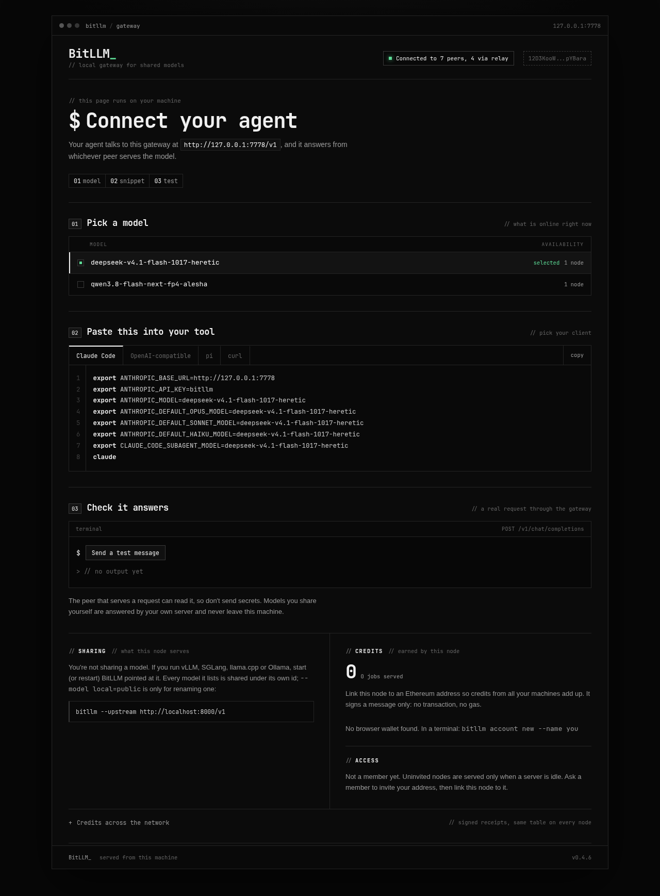

# BitLLM_

[](https://github.com/bitllm-org/bitllm/actions/workflows/test.yml)
[](https://github.com/bitllm-org/bitllm/releases)
[](LICENSE)

[English](README.md) | 中文

> 用 AI agent 帮你装？把 https://bitllm.org/llms.txt 发给它。要改代码？看 [AGENTS.md](AGENTS.md)。

**本地大模型的 BitTorrent。** 分享你自己的模型，也能用别人分享的。

每个节点跑同一个二进制。它可以把你已经在跑的 OpenAI 兼容服务（vLLM、SGLang、llama.cpp、Ollama、LM Studio、MLX 等）分享出去，同时在本机提供一个网关：你请求哪个模型，它就找哪个在线的节点回答。没有协调者：节点通过 Kademlia DHT 和 gossip 互相发现，能直连就直连，两边都在 NAT 后面时就走中继加打洞。

邀请制内测，MIT 许可。网络已经在线：[bitllm.org](https://bitllm.org)，[访问规则](#访问规则)决定谁能用上名额。使用不需要账号，也不需要钱包。



## 网络如何运作

三个角色，同一个二进制：

```
   你的节点                     seed                      GPU 主机
  127.0.0.1:7778           DHT、中继、收据              vLLM / Ollama
        │                        ▲                         ▲
        │  首次接触              │                         │
        └────────────────────────┘                         │
        │                                                  │
        └──────── 直连，或中继加打洞 ─────────────────────┘
```

- **你的节点**和其他人跑同一个二进制。网关监听 `127.0.0.1:7778`，同时支持 OpenAI 和 Anthropic 格式，agent 把它当成普通 API 用就行。互联网上的机器连不到这个网关。
- **服务节点**就是你的节点加 `--upstream`，指向你本机已经在跑的模型服务。它可以躲在 NAT 后面：其他节点通过中继加打洞找到它，不需要做端口转发。
- **seed** 是一台一直开着的公网小主机。它回答 DHT 查询、给 NAT 后面的节点做中继，并把收据历史提供给刚加入的节点同步；自己不跑模型。新节点只要能连上一个 seed（或者拿到 join code），就能认识整个网络；除非在当中继，seed 不在推理链路上。

发现分两步。二进制先解析 `_dnsaddr.bootstrap.bitllm.org` 拿到 seed 地址，之后模型在哪个节点上、怎么连过去，都由 DHT 和 gossip 负责。域名解析不到时，它会再试 `boot.bitllm.org` 后备；两个都不通，节点会自己起一个网络，并打印 join code，另一台机器用 `--bootstrap` 接上就行。

只有下面这些部分是集中托管的，而且都不在推理链路上：

| 部分 | 放在哪 | 做什么 | 挂了会怎样 |
|---|---|---|---|
| DNS 种子列表 | Cloudflare DNS，`_dnsaddr.bootstrap.bitllm.org` | 首次接触时告诉节点有哪些 seed | 有 join code 的节点仍能加入；`boot` 只能补一条缺失的记录，救不了整个 zone |
| 网站和安装脚本 | Cloudflare Worker，bitllm.org | 页面、`install.sh`、`llms.txt` | 已安装的节点照常运行；可以从 GitHub 手动安装 |
| 发布二进制 | GitHub | 下载、校验和、自动更新 | 新安装和更新暂停 |

其余全是点对点：没有协调者、没有数据库、没有 KV、没有实时地图。Cloudflare 只提供 DNS 和静态网站，不转发推理；唯一的例外是通过过渡期 `boot` 隧道中继的流量。DNS 只用来找第一个节点；推理请求从你的网关直接到服务节点，或者经过中继。现在跑 `boot.bitllm.org` 的 Mac mini 只是过渡期的后备，不属于设计的一部分。

### 每个部分依赖什么

| 部分 | 需要 | 不需要 |
|---|---|---|
| 节点和网关 | 出站网络；一个 seed 或 join code 来认识其他节点 | 入站端口、账号、钱包 |
| 服务节点 | 本机已经跑着的 OpenAI 兼容服务 | 公网 IP、端口转发、seed 角色 |
| seed | 一台有公网地址、一直开着的机器；入站 TCP 和 UDP 4001 | GPU、模型、数据库 |
| DNS 种子列表 | bitllm.org 的 DNS zone（这里是 Cloudflare）和 TXT 记录 | Worker 或任何运行时 |
| 网站和安装脚本 | 一个带静态资源的 Cloudflare Worker | KV、数据库、Mac mini |
| 自动更新 | GitHub Releases 和 `SHA256SUMS` | 包管理器 |

seed 故意和 GPU 分开：一台在训练、渲染或者干脆关机的 GPU，不能把网络发现也一起带走。新节点有一个 seed 就能加入；要可靠，至少两个不同服务商的 seed。模型细节见 [docs/bootstrap.md](docs/bootstrap.md)，部署清单见 [docs/seed-handoff.md](docs/seed-handoff.md)。

目录：[网络如何运作](#网络如何运作) · [安装](#安装并运行) · [分享模型](#分享模型) ·
[使用网络](#使用网络) · [管理节点](#观察和管理节点) · [积分](#服务积分) ·
[访问规则](#访问规则) · [seed](#运行-seed) · [注意事项](#需要知道的事) ·
[构建](#构建和测试) · [贡献](#参与贡献)

## 安装并运行

不用端口转发，也不用配置。安装脚本会自动选对版本、核对校验和，装到 `~/.local/bin`（不需要 sudo）。节点通过 DNS 种子列表加入网络，见 [docs/bootstrap.md](docs/bootstrap.md)；在过渡期，解析不到时还会试 `boot.bitllm.org`。两个都不通时，它会自己起一个网络并打印 join code：`bitllm --bootstrap /ip4/.../p2p/...`。

```bash
# macOS（Apple 芯片）、Linux（x86-64、arm64）
curl -fsSL https://bitllm.org/install.sh | sh
~/.local/bin/bitllm
```

```powershell
# Windows（PowerShell）：装到 %LOCALAPPDATA%\bitllm
irm https://bitllm.org/install.ps1 | iex
& "$env:LOCALAPPDATA\bitllm\bitllm.exe"
```

下面的例子都写 `bitllm`；如果 `~/.local/bin` 不在 PATH 里，就用完整路径（安装脚本会告诉你；Windows 上是 `%LOCALAPPDATA%\bitllm`）。想手动下载？到 [Releases](https://github.com/bitllm-org/bitllm/releases) 拿对应系统的文件；macOS 上用 curl 下载，避免浏览器打上隔离标记。

节点在前台运行。然后打开 http://127.0.0.1:7778，选一个模型，复制给你的 agent 的配置，发一条测试消息。想关了终端还继续跑，见[让它一直运行](#让它一直运行)。

运行时，另开一个终端执行 `bitllm top` 可以看到节点、交换的活和日志；见[观察和管理节点](#观察和管理节点)。

## 分享模型

你需要一个已经在本机跑着的 OpenAI 兼容服务。把节点指过去，并给模型一个网络名字：

```bash
bitllm --upstream http://localhost:8000/v1 \
  --model <你的本地名字>=deepseek-v4.1-flash-1017 \
  --concurrency 2
```

- `--model 本地=公开`：等号左边是你的服务叫的名字，右边是网络名字。**一定要用下面的统一名字**，否则别人找不到你的模型。
- 不加 `--model` 时，你的服务列出什么模型，就按它自己的名字分享什么。
- `--concurrency`：同时接几个请求。多出来的请求在这个节点的队列里等，先按访问等级、再按到达顺序；等得越久等级每 20 秒升一级，但不会超过最高等级，之后到达顺序决定，所以同级里等得最久的先走。队列满了立刻回答，不让人等一个不存在的名额。
- `--max-tokens`（默认 32768）：一个请求最多要多少新 token。每个请求只保留一个选择（`n` 会被丢掉）。
- 图片：如果你的服务限制了每个 prompt 的图片数（vLLM 的 `--limit-mm-per-prompt`），节点会从服务第一次拒绝里学到这个上限，之后只发最新的图片，旧的用一句短说明代替。Agent 每一轮都会把整个会话的截图再发一遍，这样长会话才不会撞上限。不用设置；改上限后重启节点。
- `--location LAT,LON`（可选）：声明一个粗略位置，给 `GET /network` 用。填城市里任意一点，比如 `--location 52.52,13.40`；节点只广播大约 150 公里的格子，永远不发这个点。公开地图暂时下线。不加就记为"没有位置"。细节见 [docs/network-map.md](docs/network-map.md)。

所有参数都在 `bitllm --help` 里。

### 模型统一命名

| 网络名字 | 权重 |
|---|---|
| `deepseek-v4.1-flash-1017` | DeepSeek V4.1 Flash，1017 版，官方权重 |
| `deepseek-v4.1-flash-1017-heretic` | 同上，heretic（去审查）微调 |
| `qwen3.8-flash-next-fp4-alesha` | Qwen3.8 Flash-Next，NVIDIA FP4-Local 量化，alesha 去审查微调 |
| `qwen3.8-flash-next-nvfp4-lil` | Qwen3.8 Flash-Next，官方权重，local-inference-lab 的 NVFP4-MXFP8-CSF-QAD 量化（用 NVIDIA Flare 跑：固定采样，temperature 1.0 / top-p 0.95 / top-k 20） |

同一个名字必须对应同一套权重。分享新模型前先加一行（PR 或 issue）。

**名字怎么拼：** `<模型>[-<量化>][-<来源>]`，全小写，用连字符连接。

| 部分 | 表示什么 | 什么时候省略 | 例子 |
|---|---|---|---|
| 模型 | 基础模型和版本，用厂商的名字 | 不能省 | `deepseek-v4.1-flash-1017`、`qwen3.8-flash-next` |
| 量化 | 权重格式，不是厂商原版时 | 厂商发布的原版权重 | `fp4`、`nvfp4`、`int4`、`q4_k_m` |
| 来源 | 谁改了权重：微调名，或者做量化的团队 | 厂商发布的原版权重 | `heretic`、`alesha`、`lil` |

服务怎么跑（vLLM 还是 SGLang、上下文长度、固定采样）不改变名字；写在表里备注。登记名字时开一个 issue，写清：基础模型、权重来源（链接）、量化格式和谁做的、客户端需要知道的事（固定采样、上下文长度、图片支持）。不需要提供服务器地址：节点会在网络里互相找到。

## 使用网络

每个节点，分不分享都一样，都有一个网关 `http://127.0.0.1:7778/v1`：

```bash
bitllm                                 # 只用，不分享
curl localhost:7778/v1/models
curl localhost:7778/v1/chat/completions \
  -d '{"model":"deepseek-v4.1-flash-1017","stream":true,"messages":[{"role":"user","content":"你好"}]}'
curl localhost:7778/status             # 节点 ID、连接、账本
curl localhost:7778/queue              # 名额、正在跑的活和等待队列
```

用网络不需要账号。`/v1/models` 列出此刻在线的模型，以及每个模型有几个节点在服务。

打开 `http://127.0.0.1:7778` 有控制台：给你的 agent 的现成配置、连接测试。网关同时说 OpenAI（`/v1/chat/completions`、`/v1/completions`）和 Anthropic（`/v1/messages`），Claude Code 直接能用：

```bash
M=deepseek-v4.1-flash-1017
ANTHROPIC_BASE_URL=http://127.0.0.1:7778 ANTHROPIC_API_KEY=bitllm ANTHROPIC_MODEL=$M \
ANTHROPIC_DEFAULT_OPUS_MODEL=$M ANTHROPIC_DEFAULT_SONNET_MODEL=$M ANTHROPIC_DEFAULT_HAIKU_MODEL=$M \
CLAUDE_CODE_SUBAGENT_MODEL=$M claude
```

OpenAI 兼容客户端（Cline、Continue、OpenCode、Aider 等）：Base URL 填 `http://127.0.0.1:7778/v1`，API key 随便填。Anthropic 请求要求服务方的上游支持 `/v1/messages`（vLLM 支持）。如果你自己也分享了同一个模型，网关会直接用你自己的服务回答，不出本机。响应头 `X-Bitllm-Peer` 告诉你哪个节点回答的。

## 观察和管理节点

`bitllm top` 是终端里的实时视图：你连着谁、分享了什么、和每个节点交换了多少活、日志的最后几行，每秒刷新。

```bash
bitllm top                     # 看 127.0.0.1:7778
bitllm top --interval 2s       # 慢一点刷新
bitllm top --gateway 127.0.0.1:9000
q                               # 退出；节点继续跑
```

它只通过 HTTP 读本机网关，所以随便节点怎么启动都能看：另一个终端、tmux、systemd 都行，而且不碰节点的状态。节点停了它会显示原因并一直重试，你可以开着它重启节点。在管道里（`bitllm top | cat`）它打印一帧就退出，适合 `ssh` 或写日志。

同样的数据不用终端也能拿：

```bash
curl localhost:7778/status        # 节点 ID、地址、连接、服务状态、运行时长、账本
curl localhost:7778/logs?n=50     # 节点留在内存里的最后 50 行日志
curl localhost:7778/credits       # 每个服务节点的积分
```

节点在内存里保留最后 500 行日志给 `/logs`，同时照常写 stderr，所以日志文件、`journalctl`、终端里的 `tee` 都不受影响。

### 让它一直运行

想有个能 detach 再回来的终端，用 tmux：

```bash
tmux new -s bitllm 'bitllm 2>&1 | tee -a ~/.local/state/bitllm.log'
# ctrl-b d 离开，节点继续跑；tmux attach -t bitllm 回来
```

Linux 上，用用户服务，登录时启动、停了自动重启：

```ini
# ~/.config/systemd/user/bitllm.service
[Unit]
Description=BitLLM node
After=network-online.target
[Service]
ExecStart=%h/.local/bin/bitllm
Restart=always
RestartSec=5
[Install]
WantedBy=default.target
```

```bash
systemctl --user daemon-reload && systemctl --user enable --now bitllm
loginctl enable-linger "$USER"      # 退出登录后继续跑
journalctl --user -u bitllm -f      # 日志
```

如果节点还要分享模型，把分享参数加到 `ExecStart`。macOS 上，`~/Library/LaunchAgents` 里带 `KeepAlive` 的 LaunchAgent 做同样的事。

### 更新

发布版启动 30 秒后检查一次新版本，之后每 6 小时一次。有新版就下载对应机器的二进制，核对 release 的 `SHA256SUMS`，跑一次确认它报告的版本，然后替换。如果节点正在服务，会等到没有任务在跑、队列也空了，再原地重启：同一个终端、同一个 systemd 单元、同一个节点 ID。Windows 上运行中的 `.exe` 换不掉，所以新二进制装好，下次启动时生效。

HTTPS 和校验和能挡住损坏或截断的下载。两者都来自 release 页面，所以挡不住仓库本身被攻破；签名清单是下一步。

`--auto-update=false` 留在当前版本。`bitllm update` 立刻做同样的检查（`--check` 只报告），也是 supervisor 下更新节点的方式。被替换的二进制留在旁边叫 `bitllm.prev`，`mv bitllm.prev bitllm` 就回退一个版本。源码构建（`dev`）和 CI 构建不会自更新。`bitllm --version` 打印当前版本，`GET /status` 显示上次检查。更新器要写二进制所在的目录，所以包管理器安装或者只读挂载需要 `--auto-update=false`；否则节点会记一条错误然后继续跑。

### 文件都在哪

节点存的东西都在 `~/.bitllm`（`--data` 可以改）：节点密钥、签收据用的种子、收据日志、账本、会员和额度状态。删掉这个目录就用新身份重新开始。

## 服务积分

你每服务一个任务就得到积分（prompt token / 4 + completion token），由一张收据证明：客户端签收它收到的东西（模型、token 数、响应字节的 SHA-256），你的节点核对后副签，收据通过 gossip 广播到全网。客户端每个任务用一个一次性密钥签名，所以收据只显示哪个服务端干了活，不显示谁问的。积分必须等于 token 公式，每个节点每分钟最多接受每个服务端 120 张收据（总共 600 张）。任何节点都能验证两个签名并重新算出每个人的积分：

```bash
curl localhost:7778/credits      # 每个服务节点的积分，来自这个节点见过的所有收据
```

收据存在 `~/.bitllm/receipts.jsonl`；新节点从它的 seed 节点补历史。积分以后有什么用还没定。定之前会先公布哪些收据算数：自己开小号刷自己、或者服务一个和名字不符的模型，都不算。

## 访问规则

邀请制内测。三条规则：

1. 有邀请，任何空闲名额都能用。没被邀请的节点，只在服务方空闲时才会被服务，除非服务方选择对所有人开放。
2. 默认没有每日额度限制，服务方可以自己设置。
3. 分享算力就是贡献者：永远不受额度限制；节点服务过任务后，邀请名额从 3 个变成 10 个。

还不是会员也能用网络：服务方空闲时就会服务你，用 `--open` 启动的服务方会像对待会员一样对待你。想成为会员，找一位会员邀请你的以太坊地址，然后在控制台把节点关联到这个地址（"Link wallet" 或 `bitllm account link`）。用网络不需要钱包，只有想要邀请或额度时才需要一个地址。

会员 = 根账户，或者被会员邀请的账户。你的节点服务过一次任务，就永久有 10 个邀请名额。服务方可以给每个会员设每日额度（`--free-daily`）；贡献者（最近 7 天服务过任务的节点）不受限制。根账户可以撤销一个账户，被撤销账户邀请进来的人也会一起失去资格（之后可以被别人重新邀请）。邀请由以太坊账户签名后广播；每个节点算出同样的会员集合，所以没有会员服务器。服务方通过节点的 claim 查请求方的账户（见下面）。

```bash
bitllm invite 0xADDRESS           # 用助记词账户邀请
```

用浏览器钱包的话，在控制台的 Invite 框里操作。

### 只服务指定的人（--allow）

只想分享给几个人，就列出他们的节点 ID（每个节点启动时会打印自己的 ID，`curl -s 127.0.0.1:7778/status` 里的 `id` 也是）：

```bash
bitllm --upstream http://localhost:8000/v1 --model ... \
  --allow 12D3KooW...friend1 --allow 12D3KooW...friend2
```

- 名单里的节点不管有没有被邀请，都按会员对待，任何空闲名额都能用；`--free-daily` 照样生效。
- 其他节点一律拒绝，包括会员，错误是 `403 not allowed: this server serves only the peers its owner listed with --allow. Your node is 12D3KooW...; send that id to the owner to be added`。对方的网关会跳过你、同时去找别的服务方；如果只有你在分享这个模型，它会立刻收到这句话，不用等。
- 你的模型仍然出现在所有人的 `/v1/models` 里，因为列表不是广播的。
- 不加 `--allow` 一切照旧，按上面三条规则。
- 名单只在启动时读取；改了要重启节点。

### 账户

积分记在节点上。想把自己几台机器的积分合到一个账户下，就把每个节点关联到同一个以太坊地址。只是一个签名（personal_sign）：不发交易、不花 gas、不用 RPC、不上链。Claim 由钱包和节点密钥双方签名，所以没人能认领你的节点；每个节点以最新的 claim 为准。

```bash
bitllm account new --name alice     # 新的 12 词账户，并关联这台机器
bitllm account link --name alice    # 把另一台机器关联到同一个账户
bitllm account                      # 看这台机器归谁
```

或者在控制台点 "Link wallet" 用浏览器钱包（MetaMask、Rabby 等）签名。智能合约钱包暂时不支持（它们的签名需要链上验证）。

另外，每个节点保留一份和每个节点交换的私有账本（`~/.bitllm/ledger.json`），只是数据。

## 运行 seed

seed 是新节点第一个连的节点。它回答 DHT 查询，给 NAT 后面的节点做中继直到两边打洞直连，并把收据历史提供给刚加入的节点同步。它不回答推理请求，也不决定会员资格。

seed 要和 GPU 分开。一台一直开着的便宜 VPS，或者任何有公网地址的机器，是常见选择；这样一台在训练、渲染或者关机的 GPU 不会把网络一起带走。新节点有一个 seed 就能加入；要可靠，至少两个不同服务商的 seed。

```bash
bitllm --dht-server --port 4001 \
  --announce /ip4/203.0.113.10/tcp/4001 \
  --announce /ip4/203.0.113.10/udp/4001/quic-v1
```

开放 TCP 和 UDP 4001。在一台全新的 Ubuntu VM 上，`deploy/bootstrap-vps.sh` 会装好 systemd 单元并打印要发布的 DNS 记录。家里的机器也能做 seed，用端口转发或者 UPnP；但大多数家用机器只是普通的服务节点：通过 seed 加入，别人通过中继或者打洞找到它。

`--dht-server` 强制自己对外可达，所以只有入站真的通了才开。否则节点会广播别人连不上的地址。`--dht-server` 节点也不会自动回退到默认 seed，所以第二个 seed 要指向一个活着的：
`--bootstrap /dnsaddr/bootstrap.bitllm.org`。

[docs/host-a-gpu.md](docs/host-a-gpu.md) 是一台要分享模型的机器的逐步清单，包括判断它能不能同时做 seed 的检查。`deploy/gpu-host.sh` 把服务装在模型服务旁边。

默认列表是 `_dnsaddr.bootstrap.bitllm.org` 的 DNS 种子列表。用 `deploy/seed-dns.py` 发布，新节点通过其中任意一条记录加入。加或撤 seed 是改 DNS，不是发版。DNS 列表和过渡期的 `boot.bitllm.org` 后备都连不上时，节点会自己起一个网络并打印 join code，不会失败。失败行为见 [docs/bootstrap.md](docs/bootstrap.md)，部署清单见 [docs/seed-handoff.md](docs/seed-handoff.md)。

没有公网 IP？把它放到一个能过 WebSocket 的 HTTPS 隧道后面（Cloudflare Tunnel，免费）：
`bitllm --dht-server --ws-port 4002 --announce /dns4/boot.example.org/tcp/443/wss`，隧道指向 `http://127.0.0.1:4002`。别人用
`--bootstrap /dns4/boot.example.org/tcp/443/wss/p2p/<节点 ID>` 加入。这样 Cloudflare 在连接链路上，所以只当后备，不要当主 seed。

要重启先通知。节点每 15 秒重连一次丢失的 seed，但已经在通过你的中继传输的请求会被切断，用户的 agent 不一定重试。

## 需要知道的事

- **帮你推理的节点能看到你的 prompt**，和任何推理服务商一样。传输是加密的（Noise/TLS/QUIC），但服务方机器要读明文才能推理。不要发敏感信息。
- **和你直连的节点能看到你的 IP**，服务你的节点能看到你的节点 ID。在意的话，通过 VPN 或者能走 Tor 的 VPS 使用。
- 你分享模型时，你服务的客户端也能看到你的 IP。
- **节点可能用别的模型冒充。** 启动时加 `--audit`（默认关）抽查回答你的节点：大约每 50 个请求给某个节点发一个探针，另一个节点（审计方）逐 token 打分；一直不合格的节点 24 小时内不再接这个模型的请求（`GET /audits` 看结果）。默认审计方是我们（维护者）跑的一个节点；`--auditor PEER_ID` 换掉它，`--auditor none` 关掉。打开它也不能让作弊不可能：
  - 能查出跑的是另一个模型，以及贪心请求下换成了 Q4 或更粗的量化。
  - 查不出能认出探针的节点、只在采样请求上换量化、或者把官方权重换成 heretic 这种轻度微调。
  - 审计方可以说谎：放过作弊者，或者给诚实的节点编坏分数。打乱的控制组只能抓住全放过的审计方。信任 seed 就是信任我们。
  - 同一个人的服务节点和审计方可以互相放过。同一个 owner 或者同一个 /24 的节点不会被配对，但不同网络上的未认领节点可以。
  - `--weights NAME=HASH` 只是服务方说自己加载了什么。节点只是转发它的服务，证明不了。
  数字和细节：[docs/audit.md](docs/audit.md)。
- `--upnp`（默认开）会让路由器转发 p2p 端口。
- **IPv6 会把 p2p 端口暴露在公网上。** 机器有公网 IPv6、路由器又放行入站 IPv6 时，互联网上任何人都能连到 4001 端口（只是 p2p 端口；7778 的网关只监听 127.0.0.1）。这本来是为了让别人能直连你，但如果你不想在这台机器上开放端口，启动时加 `--ipv6=false`，只在 IPv4 上监听。代价：只有 IPv6 的节点没法直连你，更多流量要走中继，可能慢一些；IPv4 上一切照旧。

## 构建和测试

Go 1.26 或更新（`mise.toml` 固定工具链）。没有 C 依赖，一个二进制；包按领域放在 `cmd/` 和 `internal/` 下。

```bash
go build -o bitllm ./cmd/bitllm
go vet ./...
go test -race ./...              # 127.0.0.1 上真实的 libp2p 节点；30 到 60 秒
```

四个平台的发布二进制和校验和由 `scripts/release.sh vX.Y.Z` 生成。测试覆盖发现、纯中继路径、服务队列、收据、账本和访问规则。目录结构和容易踩的规则见 [AGENTS.md](AGENTS.md)。

协议：`/bitllm/infer/1.1.0`（一行 JSON 请求，等待名额时零或多行 `202` 位置，然后一行 `200` 头和原样转发的上游 body），旁边是旧的 `/bitllm/infer/1.0.0`；服务端不认识 `1.1.0` 时客户端回退到它。节点通过模型名派生出的 key 在 DHT 里找服务方，用 `/bitllm/hello/1.0.0` 向服务方要最新的 announce，并把 gossip（`bitllm/announce/1`）作为空闲名额的快速路径。

## 参与贡献

Bug、修复和小功能都欢迎。[CONTRIBUTING.md](CONTRIBUTING.md) 说明 issue 和 PR 怎么处理；改代码前先读 [AGENTS.md](AGENTS.md)。改了网络、访问或者网关之后，跑一遍 external test workflow（`.github/workflows/external-test.yml`），它会加入线上网络并发送真实请求。

其他文档：[审计](docs/audit.md)、[托管 GPU](docs/host-a-gpu.md)、[seed 交接](docs/seed-handoff.md)、[网络地图](docs/network-map.md)、[兼容性](docs/compat.md)、[English README](README.md)，以及 [llms.txt](https://github.com/bitllm-org/landing-page/blob/main/public/llms.txt)（给 AI agent 的同一套说明）。品牌资源在 [bitllm-org/branding](https://github.com/bitllm-org/branding)。

## 许可证

MIT，见 [LICENSE](LICENSE)。
